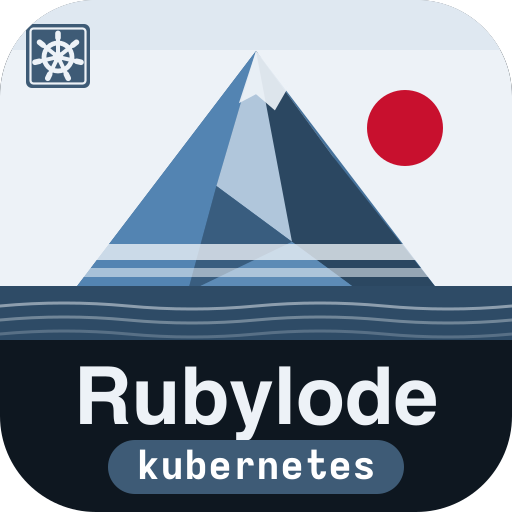
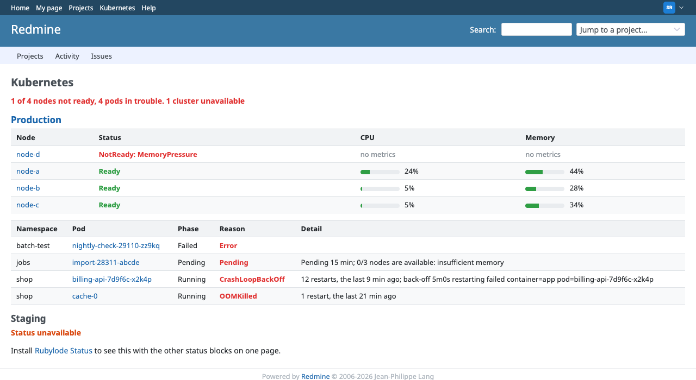
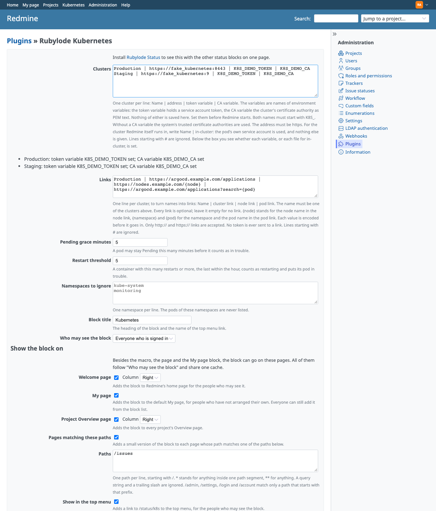
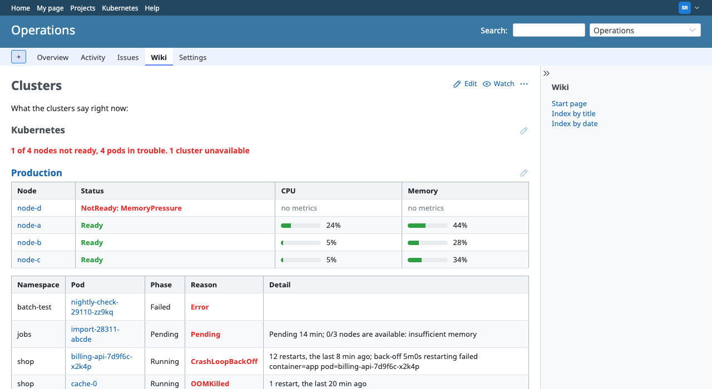

# Rubylode Kubernetes for Redmine

TL;DR: this plugin shows the health of one or more [Kubernetes](https://kubernetes.io) clusters inside
[Redmine](https://www.redmine.org): whether every node is ready, how much CPU and memory each node uses, and which pods are
in trouble and why. It comes as a wiki macro, a page, a My page block and a partial, and it puts its block on the
[Rubylode Status](https://github.com/rubylode/redmine-rubylode-status) page when that plugin is installed.

Each cluster's token stays in an environment variable and the plugin only reads. Version 1.0.1, needs Redmine 5.1 or newer
and Kubernetes 1.28 or newer. `docs/roadmap/ROADMAP.md` lists what is not done.

Contents:

- [What it does](#what-it-does)
- [Install](#install)
- [Settings](#settings)
- [Where it shows](#where-it-shows)
- [Security](#security)
- [Troubleshooting](#troubleshooting)
- [Development](#development)
- [License](#license)

## What it does

Asks each cluster you list for its nodes, its pods and its node metrics, and shows one section per cluster.

Nodes: one row each, with Ready or not (and the condition that fails, for example `NotReady: MemoryPressure`), and a CPU and
a memory bar read from the Metrics API. A bar turns amber from 80 percent and red from 90. Nodes that are not ready come
first. Without metrics-server the bars are replaced by "no metrics" and everything else still works.

Pods: only the ones in trouble are listed, each with its namespace, name, phase, reason and a detail. A pod is in trouble
when:

- a container is waiting with `CrashLoopBackOff`, `ImagePullBackOff`, `ErrImagePull`, `CreateContainerConfigError`,
  `CreateContainerError`, `InvalidImageName` or `RunContainerError` (init containers count);
- it is `Failed`;
- it has been `Pending` for the Pending grace minutes or longer (the detail carries the scheduler's message, for example
  "0/3 nodes are available: insufficient memory");
- a container was `OOMKilled` within the last hour;
- a container is restarting: it has restarted at least 5 times in all (the Restart threshold) and the last restart was
  within the hour. Kubernetes keeps the total and the last termination, not a history, so this is the rule the plugin can
  check honestly.

Healthy pods are not listed. At most 20 pods are shown and the rest are counted ("and 14 more"). Pods in namespaces you list
under Namespaces to ignore are never shown. Times read in minutes, then hours past an hour and days past a day: "Pending 14
min", "the last 3 h ago".

A summary line says "All 3 nodes ready, no pods in trouble" or "1 of 3 nodes not ready, 2 pods in trouble".

Clusters are independent. If one cannot be reached, its section says "Status unavailable" (administrators also see why) and
the others still show. A cluster's answer is cached for 60 seconds by default, and for 30 after a failure.

To keep the load on a big cluster down, pods are asked for in pages of 500 with the field selector
`status.phase!=Succeeded`, at most 10 pages, and no new page is asked for after twice Timeout seconds. If the cluster has
more pods than that, the block says "Only the first 5000 pods were checked". An answer over 10 MB is refused.

## Install

Needs Redmine 5.1 or newer, and a Kubernetes cluster (1.28 or newer) that Redmine can reach over https. The plugin has no
database migrations.

From the release zip:

1. Download `redmine_rubylode_k8s-1.0.1.zip` from the
   [releases page](https://github.com/rubylode/redmine-rubylode-k8s/releases). A `.sha256` file sits next to it.
2. Unpack it into Redmine's `plugins/` directory. The folder inside is already named `redmine_rubylode_k8s`.

From git:

    cd /path/to/redmine/plugins
    git clone https://github.com/rubylode/redmine-rubylode-k8s.git redmine_rubylode_k8s

Then:

1. Make a read-only Kubernetes account and read its token and certificate authority (below).
2. Put them in environment variables where Redmine runs, then restart Redmine
   ([Passenger](https://www.phusionpassenger.com), [Puma](https://puma.io), whatever serves it).
3. In Administration, Plugins, open Rubylode Kubernetes and choose Configure. Add a cluster.

To remove it, delete the folder and restart. The settings stay in the database as one `plugin_redmine_rubylode_k8s`
row, which you can delete.

### A read-only Kubernetes account

The plugin needs a token that can read nodes, pods and node metrics and nothing else. The role below has exactly that: get
and list on `nodes` and `pods`, and on the `nodes` of the `metrics.k8s.io` group. It does not read Secrets, ConfigMaps or
logs, and it cannot change anything.

    apiVersion: v1
    kind: ServiceAccount
    metadata:
      name: rubylode-k8s
      namespace: rubylode-k8s
    ---
    apiVersion: rbac.authorization.k8s.io/v1
    kind: ClusterRole
    metadata:
      name: rubylode-k8s-reader
    rules:
      - apiGroups: [""]
        resources: ["nodes", "pods"]
        verbs: ["get", "list"]
      - apiGroups: ["metrics.k8s.io"]
        resources: ["nodes"]
        verbs: ["get", "list"]
    ---
    apiVersion: rbac.authorization.k8s.io/v1
    kind: ClusterRoleBinding
    metadata:
      name: rubylode-k8s-reader
    roleRef:
      apiGroup: rbac.authorization.k8s.io
      kind: ClusterRole
      name: rubylode-k8s-reader
    subjects:
      - kind: ServiceAccount
        name: rubylode-k8s
        namespace: rubylode-k8s
    ---
    apiVersion: v1
    kind: Secret
    metadata:
      name: rubylode-k8s-token
      namespace: rubylode-k8s
      annotations:
        kubernetes.io/service-account.name: rubylode-k8s
    type: kubernetes.io/service-account-token

Create the namespace first (`kubectl create namespace rubylode-k8s`), then apply the file. Kubernetes fills the last Secret
with a long-lived token for the account, and with the cluster's certificate authority. On a cluster without metrics-server
the plugin still works; the bars say "no metrics". If the account may not read pods, the nodes still show and the block says
the pods could not be checked.

Read the token and the certificate authority (the CA is the PEM text, `-----BEGIN CERTIFICATE-----` and on):

    kubectl -n rubylode-k8s get secret rubylode-k8s-token -o jsonpath='{.data.token}' | base64 -d
    kubectl -n rubylode-k8s get secret rubylode-k8s-token -o jsonpath='{.data.ca\.crt}' | base64 -d

### Put them in Redmine's environment

Neither is ever typed into Redmine. Each cluster names two environment variables, and the names must start with `K8S_`, for
example `K8S_PRODUCTION_TOKEN` and `K8S_PRODUCTION_CA`. The second holds the PEM text of the cluster's certificate authority,
newlines included. Set them where Redmine runs. A trailing newline on the token is stripped, so a token pasted from a secret
works as it is.

With systemd, put both in a file that only root can read, and point the service's unit at it (`systemctl edit`). Never use
`Environment=` for them: anyone can read those values with `systemctl show`.

    [Service]
    EnvironmentFile=/etc/redmine/k8s-production.env

The file, with mode 0600 (`chmod 600 /etc/redmine/k8s-production.env`). The CA goes in double quotes, so it can span lines:

    K8S_PRODUCTION_TOKEN=the-token
    K8S_PRODUCTION_CA="-----BEGIN CERTIFICATE-----
    (the lines of the certificate)
    -----END CERTIFICATE-----"

With Docker, in the container's environment (`environment:` in Compose, or `-e K8S_PRODUCTION_TOKEN` on `docker run` with
the value taken from your secret store). A process reads its environment when it starts, so restart Redmine after setting or
changing a variable. The settings page says whether each variable is set.

A certificate authority variable that is named but holds no certificate (not set, empty, or no PEM certificate in it) makes
that cluster unavailable. The plugin never falls back to the system's trusted authorities for it, because the line asked for
a particular one.

## Settings

| Setting | Default | Meaning |
|---|---|---|
| Clusters | empty | One cluster per line; see the format below. |
| Links | empty | See [Links](#links). |
| Pending grace minutes | 5 | A pod Pending this long or longer counts as in trouble. |
| Restart threshold | 5 | A container with this many restarts or more, the last within the hour, counts as restarting. |
| Namespaces to ignore | empty | One per line. The pods of these namespaces are never listed, for example a namespace of batch jobs that fail on purpose. |
| Cache seconds, Failure cache seconds, Timeout seconds | 60, 30, 3 | Each cluster is asked at most once per cache window. After a failed answer it is left alone for the failure window. A request is given up after the timeout, with no second try. An empty field means the default. 0 turns a cache off; the timeout is at least 1. |
| Block title | Kubernetes | The heading of the block and the name of the top menu link. |
| Who may see the block | Everyone who is signed in | Or administrators only. Anonymous visitors never see it. |
| Show the block on | all off | Welcome page, My page, Project Overview page, Pages matching these paths, and Show in the top menu. See below. |

The clusters list takes one cluster per line:

    Name | address | token variable | CA variable

For example:

    Production | https://k8s.example.com:6443 | K8S_PRODUCTION_TOKEN | K8S_PRODUCTION_CA
    Staging | https://k8s-staging.example.com:6443 | K8S_STAGING_TOKEN | K8S_STAGING_CA

The address must be https. Both variable names must start with `K8S_`. Without a CA variable the system's trusted
authorities are used. `Name | in-cluster` is the cluster Redmine runs in (see [below](#redmine-in-the-same-cluster)). Lines
starting with `#` are ignored. Below the box the page says whether each variable is set.

The settings page checks each line when you save and names the line that is wrong.

### Links

Cluster headings, node names and the names of the pods in trouble can link to your own tool (Argo CD, Headlamp, a dashboard).
Without a link pattern they stay plain text. One line per cluster:

    Name | cluster link | node link | pod link

Every link is optional: leave it empty for no link. The name must be one of the clusters above. The placeholders each
kind may use:

| Link | Placeholders |
|---|---|
| Cluster link | none |
| Node link | `{node}` |
| Pod link | `{namespace}` and `{pod}` |

Rules:

- Each value is percent-encoded as it goes in, so a name cannot add a path, a query or a fragment of its own.
- A placeholder may not appear in the scheme, the user, the host or the port. Names in Kubernetes are domain names, and a pod
  called `evil.example.com` must not be able to choose where a link goes.
- Only `http` and `https` links are accepted, with a host and no user name.
- Braces are reserved: a literal `{` or `}` anywhere else makes the line refused.
- No token is ever sent to a link. Redmine never calls it.

For example, with Argo CD (the pod name goes into its application search):

    Production | https://argocd.example.com/applications | | https://argocd.example.com/applications?search={pod}

### Redmine in the same cluster

When Redmine runs in the cluster it should show, write the line with only a name and `in-cluster`:

    Here | in-cluster

The plugin then uses the pod's own service account: the address `https://kubernetes.default.svc`, the token at
`/var/run/secrets/kubernetes.io/serviceaccount/token` (read again on each refresh, because Kubernetes rotates it) and the
certificate authority at `.../ca.crt`. Bind the role above to that service account (the one Redmine's pod runs as) and no
variables are needed. The settings page says whether the files exist.

## Where it shows

- Wiki macro: `{{k8s_status}}`, or `{{k8s_status(title=Our clusters)}}`. People who may not see it get nothing where it
  stands.
- Page: `/status/k8s`.
- My page block: "Kubernetes" in the list of blocks you can add to My page.
- Partial, for other plugins and themes: `render partial: "rubylode_k8s/status"` (locals `title`, `show_title` and
  `compact`).
- Rubylode Status: with that plugin installed the block also shows on its Status page, as a widget with a summary such as
  "1 of 4 nodes not ready, 4 pods in trouble".

### Status page

With [Rubylode Status](https://github.com/rubylode/redmine-rubylode-status) installed, the block shows on its Status page, and
this plugin drops its own top menu item. Without it, nothing else changes and the settings page says where to get it.

### Other pages

The same block, with the same permission setting and the same cache, can be put in many places. The placements are under
"Show the block on" on the settings page.

| Where | How | Needs a setting |
|---|---|---|
| Wiki pages, news, issues, project descriptions, the welcome text | the macro `{{k8s_status}}` | no |
| My page, as a block you can move | pick "Kubernetes" in the Add list | no |
| Welcome page, left or right column | check "Welcome page" | Welcome page |
| The default My page | check "My page" | My page |
| Project Overview page, left or right column | check "Project Overview page" | Project Overview page |
| Any other page, such as the issue list | check "Pages matching these paths" and list the path | Pages matching these paths |
| Its own page | open `/status/k8s` | no |
| The top menu | check "Show in the top menu" | Show in the top menu |
| A theme or another plugin | render the partial | no |

"My page" adds the block to the default My page, the one people get until they arrange their own. Everyone can still add it
from the block list.

The path list takes one pattern per line and draws a small version of the block at the top of each matching page:

    /issues
    /projects/*/issues

`*` stands for anything inside one path segment, `**` for anything including slashes. A query string and a trailing `/` are
ignored. A pattern must start with `/`. Pages under `/admin`, `/settings`, `/login` and `/account` match only a pattern that
itself starts with that prefix. A page that already shows the block is not given a second one.

For a theme or another plugin's view, the partial draws nothing for people who may not see the block:

    <%= render partial: "rubylode_k8s/status" %>
    <%= render partial: "rubylode_k8s/status", locals: { compact: true, title: "Clusters", show_title: false } %>

Locals, all optional: `title` replaces the block title, `show_title: false` hides it, `compact: true` gives the small variant
without the pod detail column.

"Show in the top menu" adds a link to `/status/k8s`, named like the block title. Only people who may see the block get it.

## Security

A token is never saved in Redmine's database, never shown on a page, never written to the log and never part of an error
message (errors name the problem, not the token). It is read from an environment variable when a request is made.
An unexpected error never breaks the page. If the nodes cannot be read, the cluster says "Status unavailable"; if only the metrics or the pods fail, that part is left out ("no metrics", "pods not checked") and the rest still shows. Administrators see only the error's class name, never its message.

- Only `K8S_...` variables are read. The settings accept a variable name only if it matches `K8S_[A-Z0-9_]+`, and the check
  is made again every time one is read. A name like `SECRET_KEY_BASE` or `DATABASE_PASSWORD` is refused when you save the
  settings, and if it is somehow in the database anyway the token counts as missing and nothing is sent. Otherwise an
  administrator could point the plugin at one of Redmine's own secrets and an address of their choosing.
- A token goes to one host. Each cluster line binds a token to one address, and the token is sent only there. A redirect is
  never followed, so the token cannot be passed on to another host; the block says "Status unavailable" and administrators see
  that Kubernetes redirected.
- https only. The Kubernetes API always speaks TLS, so an `http://` address is refused when you save it and nothing is sent
  at runtime, loopback included. A cluster with a CA variable is trusted only by that certificate authority, and one whose CA
  variable holds no certificate is unavailable, not trusted by the system store.
- The plugin sends only three GET requests: `/api/v1/nodes`, `/api/v1/pods` and `/apis/metrics.k8s.io/v1beta1/nodes`. It
  asks for no Secrets, ConfigMaps or logs and takes no action: no restart, scale, delete or exec. The account should hold only
  the role above, so a leaked token can read nodes and pods and nothing more.
- Only administrators see why a cluster is unavailable. The reason can name a status code or an error, which other people do
  not need.
- Links never carry a token, and a name from the cluster can only fill the path or the query of a link, never its host.
- Give Redmine its own Kubernetes account, so you can revoke its token without touching anyone else's access.
- With Rubylode Status installed, its read-only `/status.json` token returns this plugin's summary (the state, the one-line
  summary and, per cluster, its name, state and a short detail) to whoever holds that token. That is the Status plugin's
  contract. Treat that token as you would a view of the block, and see its documentation for who may use it.

## Troubleshooting

- The block says "Status unavailable": administrators see the reason under it. Common ones are "No token for ..." (the
  variable is not set in Redmine's environment, or was set after Redmine started; the settings page says whether it is),
  "The certificate authority variable of ... holds no certificate", "Kubernetes answered 401" (a wrong or expired token),
  "Kubernetes answered 403" (the account may not read nodes), "Kubernetes could not be reached (...)" (the address, the
  network, or a certificate the authority does not sign), a refused plain http address, and a redirect.
- Pods are not listed and the block says "Pods could not be checked": the account may not list pods. The nodes still show.
- The bars say "no metrics": the cluster has no metrics-server, or the account may not read `metrics.k8s.io`. Administrators
  see which.
- The block does not show: "Who may see the block" decides, and anonymous visitors never see it. With no cluster set up,
  only administrators see a hint.
- A pod you expect is missing: its namespace may be under Namespaces to ignore, or it has not yet been Pending for the
  grace minutes or reached the Restart threshold, or its last restart was more than an hour ago.
- A cluster's answer is up to Cache seconds old (60 by default).
- The top menu link is missing: with Rubylode Status installed the link is the Status plugin's.

## Development

Tests are Minitest and run in a Redmine 7 image (`docker/`), with Docker:

    bin/test                                              all unit and integration tests
    bin/test test/integration/wiki_macro_test.rb          one file

The tests run against a fake Kubernetes API, `test/support/fake_kubernetes_api.rb`. It is a small Ruby script that answers the
three calls the plugin makes over https, with the status codes and `Status` bodies a real API server gives, from scrubbed
fixtures with made-up names. It can run on its own:

    ruby test/support/fake_kubernetes_api.rb

`FAKE_KUBERNETES_PORT`, `FAKE_KUBERNETES_TOKEN` and `FAKE_KUBERNETES_HOST_NAMES` change its port, token and extra host names,
`FAKE_KUBERNETES_CA_PATH` names a file to write its certificate authority to, and `FAKE_KUBERNETES_SHIFT_TO_NOW=1` moves
every timestamp so the fixtures read as taken just now. The Status plugin is not in the test image, so the tests use a
stand-in for its registry.

To try the plugin by hand, `bin/demo up` starts a throwaway Redmine on http://127.0.0.1:3018 (admin / admin) next to the fake,
with two clusters, a person (`sam.rivera` / `demo-password-1`) and the placements on. `bin/demo scenario NAME` switches what
the fake reports (`all_ready`, `one_not_ready`, `no_metrics`, `unavailable`), `bin/demo restart` picks up a change to the
plugin, `bin/demo down` stops it and `bin/demo reset` wipes it. `npm install && npm run screenshots` retakes the pictures in
this README from it.

Pull Requests are welcome!

### Releasing

Push a `vX.Y.Z` tag whose version matches `version` in `init.rb` and has an entry in `CHANGELOG.md`. CI runs the tests, builds
`redmine_rubylode_k8s-X.Y.Z.zip` with a `.sha256` file and publishes the GitHub release with the changelog entry as its
notes. To build a release for a tag that already exists, use Actions, release, Run workflow. `docs/redmine-org-listing.md`
has the text for the redmine.org listing.

## License

GNU General Public License, version 2 or (at your option) any later version, the same as Redmine. See `LICENSE`.

Copyright (C) 2026  Nick Gorbikoff

No warranty, as the GPL says. The plugin only reads from Kubernetes, but it holds a token for it, so read the Security section
and try it on a copy of your tracker first. It is tested in CI on Redmine 7.0, 6.1, 6.0 and 5.1, against a fake API that follows
the answers of Kubernetes 1.28 and newer, not against every Kubernetes release.
